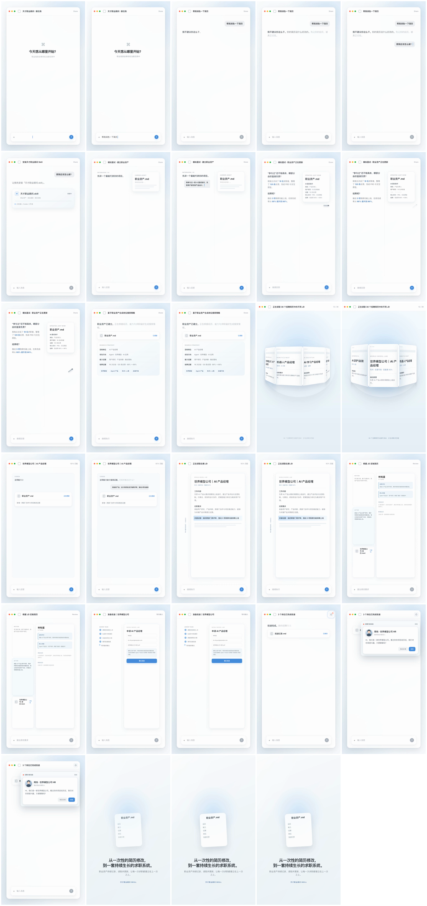

# Skill 动画宣传片@泛函

把一个真实的 Agent Skill，制作成一条可继续修改的 9:16 中文动画宣传片。

它不是录屏工具，也不是把 README 功能逐条念一遍。它会先找到一个真实用户任务，再用 Codex 浅色产品界面展示：用户提出问题、Agent 做出判断、连续执行、生成文件或结果，最后完成一次清楚的价值闭环。



## 能做什么

- 从目标 `SKILL.md`、README、参考资料和真实输出中提取可验证事实。
- 有用户剧本时锁定剧本；没有剧本时基于 Skill 自行构思单线故事。
- 根据用户指定的 BGM 安排节奏、重拍和转场。
- 用 HTML、CSS、GSAP 编写 Codex 风格的可编辑界面动画。
- 用 HyperFrames 生成关键帧、低清预览和最终 MP4。
- 检查白闪、跳帧、溢出、文字错位、音乐硬切和未经证实的宣传主张。

## 最简单的使用方法

把本目录安装到 Codex Skills 后输入：

```text
使用 $skill-promo-film-fanhan，根据这个 Skill 和我选择的 BGM，生成一条竖屏动画宣传片。
```

至少提供：

1. 目标 Skill 的目录、`SKILL.md` 或仓库地址；
2. 已选定的 BGM 文件。

剧本可选。没有说明剧本时，Skill 会先问：

> 如果你有剧本的话，可以给我；没有的话，我就基于这个 Skill 自己思考并生成一版。

提供剧本后，Agent 只修正事实错误、不可实现内容和明显超时，不擅自更换核心故事。明确没有剧本时，Agent 才自行构思。

## 输出

一次完整交付包含：

```text
facts.json                    # 宣传事实与来源
promo.json                    # 画幅、输入、剧本模式和时间轴配置
storyboard.md                 # 分镜、文案、动效、声音与事实 ID
assets/bgm.analysis.json      # 音乐结构与时间点
keyframes/contact-sheet.png   # 关键帧总览
renders/draft.mp4             # 审片版本
renders/final.mp4             # 最终成片
qa-report.json                # 内容、布局、转场与声音检查
```

同时保留完整的可编辑 HyperFrames 工程。

## 默认风格

- 1080×1920、30 fps、中文。
- 白、浅灰、黑、浅蓝的 Codex 浅色界面。
- 用户输入：光标打字机；AI 输出：逐字淡入。
- 相邻场景共享视觉锚点，旧场景轻微缩小和虚化，新场景从同一位置接管。
- 不使用蓝色点击圆圈、无意义粒子、装饰性科技光效或真实 Codex 录屏。
- 时长、镜头数和业务剧情不固定，以故事和音乐为准。

## 技术结构

- [HyperFrames 0.8.35](https://github.com/heygen-com/hyperframes) 负责 HTML 时间轴检查、预览与视频渲染。
- [GSAP 3.14.2](https://gsap.com/) 负责界面转场、文字、卡片和状态动画。
- `music-animation-analyzer` 负责分析用户指定 BGM 的段落和重拍。
- 内嵌的 [motion-web](https://github.com/feitangyuan/motion-web) 固定于提交 `440316bfbb0f527c8775ff9104189d1b0db99ce9`，负责运动物理、编舞、手感与验证方法。

`motion-web` 不接管本 Skill 的视觉设计，也不会把成片改造成滚动网站。只复用机制，不复制上游案例的配色、字体、文案和版式。

## 本地创建工程

```bash
node scripts/create-project.mjs \
  --skill /path/to/target-skill \
  --music /path/to/bgm.mp3 \
  --script /path/to/script.md \
  --output /path/to/new-promo
```

没有剧本时省略 `--script`。`promo.json` 会分别记录 `user-provided` 或 `agent-generated`，避免把 AI 自行生成的剧本冒充用户确认稿。

## 验证

```bash
node scripts/test-create-project.mjs
```

创建出的工程中运行：

```bash
npm install
npm run check
npm run render:draft
npm run render
```

## 目录

```text
SKILL.md                      # Agent 工作流与硬约束
agents/openai.yaml            # Codex 展示信息与默认提示词
assets/codex-light-template/  # 可编辑动画模板
references/                   # 故事、视觉、QA 与许可规则
scripts/                      # 工程生成器和最小回归检查
vendor/motion-web/            # 固定上游版本、许可证与验证能力
```

## 许可与素材

- `vendor/motion-web/` 遵循其 MIT License，原作者版权与完整许可保留在 [`vendor/motion-web/LICENSE`](vendor/motion-web/LICENSE)。
- GSAP 使用其 Standard License；HyperFrames 和其他运行依赖按各自许可证使用。
- 用户 BGM、第三方参考视频、`node_modules`、缓存与临时帧不会进入公开 Skill 包。
- 最终成片公开发布前，使用者仍需确认音乐、图片、字体和品牌素材的授权范围。

更具体的来源说明见 [`references/sources-and-licensing.md`](references/sources-and-licensing.md)。
